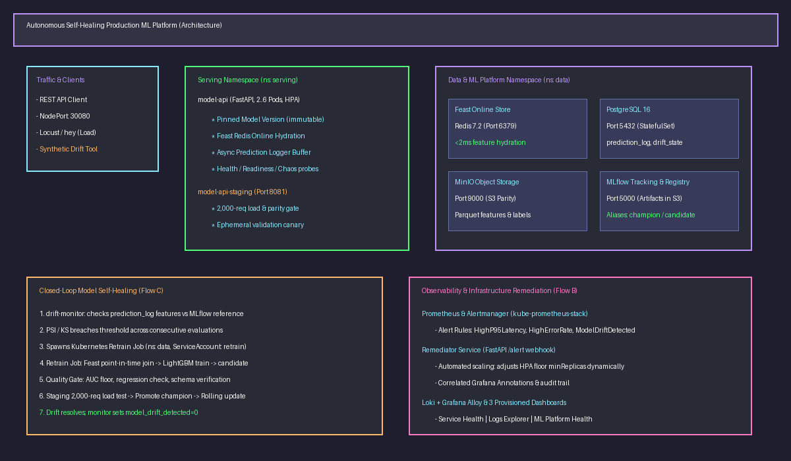
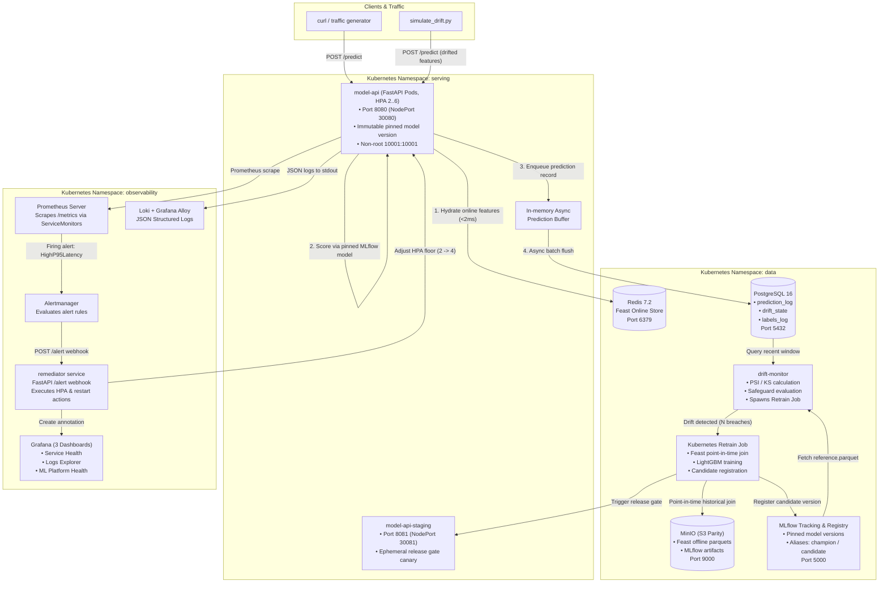
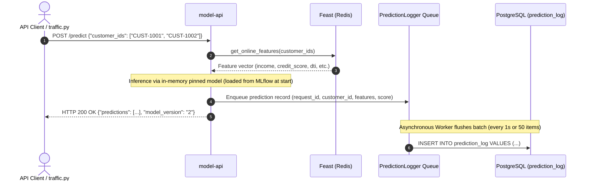

# System Architecture & Technical Design

This document details the complete end-to-end architecture of the Autonomous Self-Healing Machine Learning Platform.



---

## 1. System Topology & Architecture Diagram



---

## 2. Component Catalog

| Component | Technology | Namespace | Ports / Resources | Purpose & Responsibilities |
|---|---|---|---|---|
| **model-api** | FastAPI, Python 3.11, Uvicorn | `serving` | 8080 (NodePort 30080)<br>Req: 100m/256Mi, Lim: 500m/512Mi | High-throughput low-latency inference service. Hydrates features from Redis, evaluates pinned model, asynchronously logs inferences to Postgres. |
| **model-api-staging** | FastAPI, Helm Release | `serving` | 8081 (NodePort 30081)<br>Ephemeral | Pre-production validation environment. Runs 2,000-request load check, latency gate, and smoke tests before champion promotion. |
| **Feast Online Store** | Redis 7.2 (Alpine) | `data` | 6379<br>Req: 50m/128Mi, Lim: 200m/256Mi | Sub-millisecond key-value storage for real-time customer feature hydration. |
| **Feast Offline Store** | Parquet on MinIO / S3 | `data` | S3 API (`s3://ml-data/feast/`) | Point-in-time correct historical feature joins (`get_historical_features`) for model training and retraining without data leakage. |
| **Model Registry** | MLflow 2.18.0 | `data` | 5000 (NodePort 30500)<br>Postgres backend + MinIO store | Centralized metadata registry storing pinned model artifacts, reference distributions, signatures, hyperparameters, and aliases (`champion`, `candidate`). |
| **Metadata Database** | PostgreSQL 16 | `data` | 5432 (StatefulSet)<br>Req: 100m/256Mi, Lim: 500m/512Mi | Relational persistence for inference history (`prediction_log`), drift audit logs (`drift_state`), and true labels (`labels_log`). |
| **Object Storage** | MinIO (S3-compatible object store) | `data` | 9000 (S3 API), 9001 (Console)<br>Req: 100m/256Mi, Lim: 500m/512Mi | S3-compliant bucket storage for training datasets, historical Parquet logs, and serialized MLflow model artifacts. |
| **Drift Monitor** | Python 3.11, SciPy, NumPy | `data` | Daemon / Cron execution<br>Req: 100m/256Mi, Lim: 250m/512Mi | Continuously evaluates Population Stability Index (PSI) and Kolmogorov-Smirnov (KS) statistics against the model's MLflow reference distribution. Spawns retrain Job on breach. |
| **Retrain Job** | Kubernetes Batch Job | `data` | Ephemeral Job pod<br>Req: 250m/512Mi, Lim: 1000m/1Gi | Point-in-time historical join via Feast, LightGBM training, evaluation on temporal holdout, MLflow model registration with `candidate` alias. |
| **Remediator** | FastAPI, Kubernetes Client | `observability` | 8000 (ClusterIP)<br>Req: 50m/128Mi, Lim: 200m/256Mi | Automated incident response webhook receiving Alertmanager alerts. Executes live HPA floor adjustments and Grafana event annotations. |
| **Prometheus & Alertmanager** | kube-prometheus-stack | `observability` | 9090 (Prometheus), 9093 (Alertmanager) | Metrics scraping via ServiceMonitors, threshold evaluation, and alert dispatching. |
| **Loki & Alloy** | Grafana Loki + Alloy | `observability` | 3100 (Loki)<br>DaemonSet shipper | Cluster-wide structured JSON log ingestion and querying. |
| **Grafana** | Grafana 11.5.0 | `observability` | 3000 (NodePort 30000) | Visual command center with 3 provisioned dashboards: Service Health, Logs Explorer, and ML Platform Health. |

---

## 3. The Three Core Operational Flows

### 3.1 Flow A — Serving (Request Path)

* **Performance Guarantee:** Serving latency is completely decoupled from database latency. If PostgreSQL degrades or restarts, the in-memory queue buffers predictions without failing user requests.

### 3.2 Flow B — Infrastructure Self-Healing
```mermaid
sequenceDiagram
    autonumber
    actor Chaos as Traffic Surge / Fault Injection
    participant API as model-api
    participant Prom as Prometheus
    participant AM as Alertmanager
    participant Rem as remediator
    participant K8s as Kubernetes API (HPA)
    participant Graf as Grafana

    Chaos->>API: High latency injection / traffic burst
    API->>Prom: Expose high request duration in /metrics
    Prom->>AM: Fire Alert: HighP95Latency (P95 > 200ms)
    AM->>Rem: POST /alert webhook with alert payload
    Rem->>Rem: Validate cooldown & deduplication
    Rem->>K8s: PATCH HPA model-api minReplicas (2 -> 4)
    Rem->>Graf: POST /api/annotations (Incident logged)
    K8s->>API: Provision additional pods on cluster nodes
    Note over API: Latency stabilizes; Alert resolves; HPA floor restores
```
* **Resilience Guarantee:** Automated scaling and self-healing occur within 30-45 seconds of threshold breach without human intervention.

### 3.3 Flow C — Autonomous Model Self-Healing (Closed Loop)
```mermaid
sequenceDiagram
    autonumber
    participant Client as Production Traffic
    participant PG as PostgreSQL (prediction_log)
    participant MLflow as MLflow Registry
    participant Mon as drift-monitor
    participant Job as Retrain Job
    participant Gate as Release Gate
    participant Staging as model-api-staging
    participant Prod as model-api-prod

    Client->>PG: Inferences logged to prediction_log
    loop Every Evaluation Interval (30s)
        Mon->>PG: SELECT features FROM prediction_log WHERE ts >= NOW() - window
        Mon->>MLflow: Fetch reference.parquet for active champion
        Mon->>Mon: Compute PSI & KS per feature
    end
    Note over Mon: PSI > 0.20 on Delinquencies & Income across 2 evaluations
    Mon->>Job: Spawn Kubernetes Batch Job (retrain-v{N})
    Job->>Job: Point-in-time join via Feast get_historical_features
    Job->>Job: Train LightGBM & evaluate on holdout
    Job->>MLflow: Log run, metrics, reference.parquet, register as candidate
    Job->>Gate: Trigger release gate (scripts/run_gate.sh)
    Gate->>Gate: Verify AUC floor & non-regression vs champion
    Gate->>Staging: Deploy candidate to staging (Port 8081)
    Gate->>Staging: Run 2,000-request load & latency test
    Gate->>MLflow: Promote candidate -> champion alias
    Gate->>Prod: Rolling update prod to new model.version (zero-downtime)
    Prod-->>Mon: New model serves with updated reference distribution
    Note over Mon: Drift metric drops below threshold; loop successfully closes!
```

---

## 4. Platform Data Model

### 4.1 PostgreSQL Schema
```sql
-- Inference audit log
CREATE TABLE prediction_log (
    request_id UUID PRIMARY KEY,
    ts TIMESTAMPTZ NOT NULL DEFAULT NOW(),
    model_version VARCHAR(64) NOT NULL,
    customer_id VARCHAR(64) NOT NULL,
    features JSONB NOT NULL,
    score FLOAT NOT NULL,
    latency_ms FLOAT NOT NULL
);
CREATE INDEX idx_predlog_ts ON prediction_log (ts);
CREATE INDEX idx_predlog_version ON prediction_log (model_version);

-- Drift monitoring history
CREATE TABLE drift_state (
    id SERIAL PRIMARY KEY,
    evaluated_at TIMESTAMPTZ NOT NULL DEFAULT NOW(),
    model_version VARCHAR(64) NOT NULL,
    feature_name VARCHAR(64) NOT NULL,
    metric_type VARCHAR(32) NOT NULL, -- 'psi' or 'ks'
    metric_value FLOAT NOT NULL,
    threshold FLOAT NOT NULL,
    drift_detected BOOLEAN NOT NULL,
    sample_size INT NOT NULL
);

-- Ground truth label stream
CREATE TABLE labels_log (
    customer_id VARCHAR(64) NOT NULL,
    event_timestamp TIMESTAMPTZ NOT NULL,
    label INT NOT NULL,
    created_at TIMESTAMPTZ NOT NULL DEFAULT NOW(),
    PRIMARY KEY (customer_id, event_timestamp)
);
```

### 4.2 Feast Feature Store Definitions
* **Entity:** `customer_id` (Type: `STRING`, Description: "Unique financial customer identifier")
* **Feature View:** `customer_credit_features`
  * Entity: `customer_id`
  * Features:
    * `credit_score` (INT64)
    * `annual_income` (FLOAT)
    * `debt_to_income` (FLOAT)
    * `loan_amount` (FLOAT)
    * `employment_length_years` (INT64)
    * `delinquencies_2yrs` (INT64)
  * Online Store: Redis (`redis://redis.data.svc:6379/0`)
  * Offline Store: MinIO S3 (`s3://ml-data/feast/features_latest.parquet`)
* **Feature Service:** `loan_default_v1`

### 4.3 MLflow Artifact & Model Storage
```
s3://mlflow-artifacts/
  └── 1/                               # Experiment ID
      └── <run_id>/
          ├── artifacts/
          │   ├── model/               # MLflow sklearn model package
          │   │   ├── MLmodel          # Model flavor & signature specification
          │   │   ├── model.pkl        # Serialized LightGBM pipeline
          │   │   └── requirements.txt # Pinned inference dependencies
          │   ├── reference.parquet    # Frozen baseline feature distribution (PSI reference)
          │   └── eval_set.parquet     # Frozen temporal validation holdout
          ├── metrics/                 # auc, f1_score, log_loss, latency_ms
          └── params/                  # learning_rate, n_estimators, feast_service
```

---

## 5. Architectural Decision Records (ADR Summary)

| Decision | Rationale | Alternatives Considered |
|---|---|---|
| **Immutable Model Version Pinning** | Helm `model.version=<N>` pins exact model version in Pod spec. Rolling updates are reproducible, atomic, and strictly traceable. | Floating on MLflow `champion` alias (rejected: creates non-deterministic cluster state and breaks GitOps). |
| **Reference Distribution Tied to Model Run** | Drift monitor reads `reference.parquet` directly from the active champion's MLflow run. Retraining recalculates the reference from the new training set. | Fixed global baseline or rolling window baseline (rejected: causes endless retraining loops or hides gradual drift). |
| **Point-in-Time Correct Feature Joins** | Feast `get_historical_features` joins customer entities with feature state as of event timestamp. | Simple SQL JOINs on current feature tables (rejected: causes catastrophic data leakage from future state into training). |
| **In-Memory Buffered Prediction Logging** | FastAPI request handler pushes logs to an in-memory deque; background thread flushes micro-batches to Postgres. | Synchronous DB insert per request (rejected: adds 5-15ms DB round-trip latency to critical inference path and causes 500s when DB restarts). |
| **Terraform & Kind for Azure Parity** | 100% Terraform-driven local stack plus an Azure VM cloud host running the identical kind platform, with zero cloud billing during active development. | LocalStack (rejected: free tier restricted) or direct AWS development (rejected: \$100s in unnecessary student cloud spend). |
| **Grafana Alloy over Promtail** | Promtail has been deprecated upstream by Grafana Labs; Grafana Alloy is the official long-term log collector. | Promtail (rejected: EOL status). |
| **Unified Release Pipeline for Code & Models** | Both software changes and retrained ML candidates use the identical gate (`gate.py`), staging load check, and Helm deployment script. | Separate pipelines for code vs model releases (rejected: leads to configuration drift and untested model delivery paths). |
